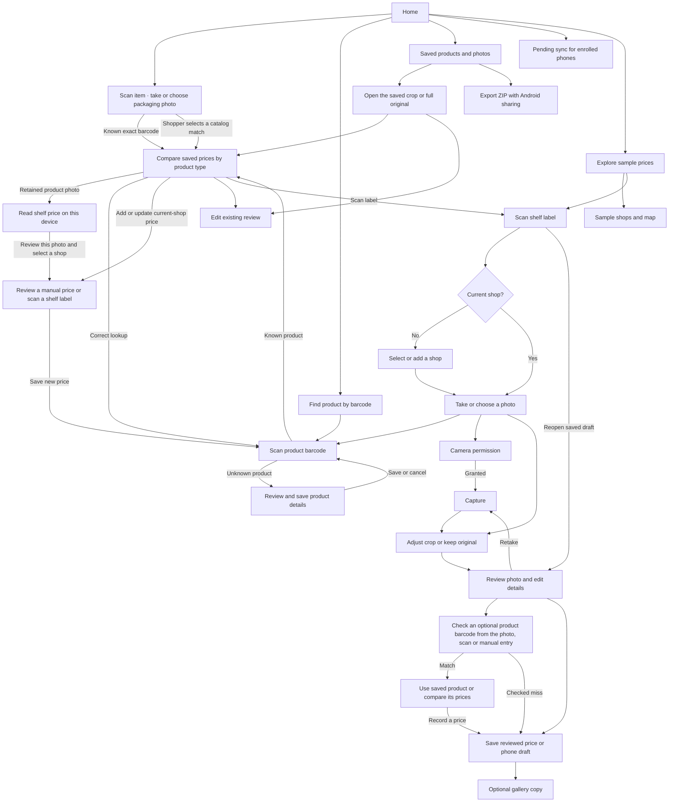

# Cheapo app map

The [domain glossary](domain-glossary.md) defines the shopping terms used here and
in planned work.

## Current user flow

The [Home route](../apps/mobile/app/index.tsx) shows the current shop. On mobile,
**Scan item** starts a packaging photo lookup, and **Find product by barcode**
opens the dedicated scanner. The sample price browser remains available. Home restores the saved selection when focused. Use **Change shop → Edit** to
update a shop's name, nickname, or address, or remove it from the saved shop list.
Removal clears the current selection if that shop was selected. Previous price
records and photos keep their saved shop details.

## Where to make changes

| Responsibility | Current implementation |
| --- | --- |
| Current shop | [Home](../apps/mobile/app/index.tsx) and price capture in [Scan](../apps/mobile/app/scan.tsx) use a [shared chooser](../apps/mobile/component/shop/shop-chooser.tsx). The [shop repository](data-repositories.md) supplies the saved list and current selection. Shelf-label capture needs a current shop, including from a direct link. Packaging lookup can start without one. |
| Home barcode lookup | [Find product by barcode](../apps/mobile/app/find-product.tsx) opens the existing barcode scanner from mobile Home. Lookup and comparison work without a current shop, and an existing selection supplies the current-shop price action. **Scan label** asks for a shop when needed. |
| Add product | On a connected shopping build, [Add product](../apps/mobile/app/add-product.tsx) starts from Home or carries the photo and reviewed details from packaging lookup. Scan or type a barcode, choose a possible match, or intentionally add after a checked miss. The [review form](../apps/mobile/component/add-product-price-review.tsx) can prefill a clear local shelf price for a chosen catalog product. AI suggestions are optional and run on request. Confirmation requires the current shop and a reviewed price. Cheapo stages the price and original photo first so unavailable lookup can resume from Pending sync. |
| Camera | The [Scan route](../apps/mobile/app/scan.tsx) mounts the [camera component](../apps/mobile/component/camera.tsx), which owns permissions, preview, capture, retake, and the photo workflow. |
| Packaging photo lookup | [Photo product lookup](../apps/mobile/component/photo-product-lookup.tsx) checks a barcode decoded from the original Android photo or entered by the shopper. An exact match opens comparison with a temporary reference to the retained photo. [Local shelf-price evidence](../apps/mobile/component/use-shelf-photo-evidence.ts) can prefill an editable current-shop price only when the photo clearly supports the amount, product and pack. An unreadable or missing price leaves manual review and optional AI available. Saving requires the current shop and an explicit confirmation. [Packaging details](../apps/mobile/component/product-candidate-lookup.tsx) also support manual lookup and optional [photo identity suggestions](../apps/mobile/component/direct-photo-analysis.tsx) on a supported ChatGPT-connected build. Shoppers choose and apply any suggested fields before checking the catalog. A possible match opens comparison after the shopper selects it. Returning keeps the photo and lookup details. |
| Shared Android enrollment | [Cheapo access](../apps/mobile/app/cheapo-access.tsx) verifies an operator-issued credential. The [connected provider](../apps/mobile/component/connected-shopping-provider.tsx) selects the protected owner and runs sync on app start, foregrounding and regained connectivity. The phone talks to the HTTPS API. PostgreSQL stores shopping records and private object storage holds photo evidence. |
| Protected sync | The [shopping runtime](../apps/mobile/data/shopping-sync-runtime.ts) drains price, catalog, shop and preference changes after local commits. Photo evidence syncs separately. [Pending sync](../apps/mobile/app/pending-sync.tsx) shows failed changes, missing shops and conflicts. If another shopper saves the same barcode first, the pending price and photos stay protected until the shopper reviews and reuses the matching product. An [existing price edit](../apps/mobile/app/edit-price/%5Bid%5D.tsx) uses the same record and version, with a reversible Recorded in error flag. |
| Photos | The [crop editor](../apps/mobile/component/photo-crop.tsx) uses [crop geometry](../apps/mobile/data/crop-geometry.ts) and [image manipulation](../apps/mobile/lib/photo-crop.ts). It derives a JPEG from the original and keeps both available in the draft. |
| Review | The [review form](../apps/mobile/component/photo-review.tsx) edits product, price, currency, and optional type, variety, brand, pack size and unit-price details. If no unit amount and basis were entered, a known pack size supplies the calculated unit price. Product type is a reviewed comparison category, for example dry rice or microwave rice. New drafts store the selected shop's stable ID and display name at capture. A later selection applies to subsequent captures. Older drafts still support their saved free-text shop field. Incomplete details can still be saved as a draft. |
| Storage | The [local price store](../apps/mobile/data/local-photo.ts) writes a JSON manifest in the app’s private directory, with JPEGs for photo reviews. A manually recorded price requires a completed review, product ID and shop snapshot. Scan reopens saved photo drafts. The [gallery helper](../apps/mobile/lib/photo-gallery.ts) copies the selected image only on request after saving. |
| Export | On Android, **Saved products and photos → Export saved products and photos** opens the share sheet with a private ZIP. [Version 3](data-repositories.md#offline-shopping-backup) preserves saved local records, images and catalog history. Enrolled exports use version 4 and add owner-bound recovery files and pending work. The migration importer accepts versions 1–3. Completed archives stay in Android-managed cache for the sharing app. |
| Saved price comparison | [Compare](../apps/mobile/app/compare/%5Bid%5D.tsx) opens from a completed saved review. It compares completed reviews of the same type and currency. Enrolled phones use the [shared reader](../apps/mobile/data/use-saved-price-reads.ts) and protected pending changes. The variety and brand filters can be used independently or together. Compatible unit prices are normalized and sorted ascending. The lowest comparable price is highlighted, including the selected reference where it is cheapest. Scan label opens the existing camera flow, and Scan product barcode opens barcode scanning. Records without a comparable unit price are shown separately. **Edit** opens the original price and unit in the shared review form. Saving updates only the existing record’s review and refreshes the comparison. |
| Product barcode | [Scan](../apps/mobile/app/scan.tsx) requires a selected shop for both label and [barcode capture](../apps/mobile/component/barcode-scan.tsx). The [local product lookup](../apps/mobile/data/local-products.ts) or [enrolled catalog](../apps/mobile/data/enrolled-catalog.ts) uses the canonical GTIN to find an exact product ID and its comparison category. An enrolled lookup reports when it could not check the service. The most recent completed observation explicitly linked to that ID can anchor the comparison. The barcode result offers a lookup correction or an explicit barcode edit for the named saved product. The local catalog publishes both sides of a replacement together, while retaining the product ID. The current shop offers **Add price** or a dated price and **Update price**. Manual price entry and linked photo review display the saved barcode. A reviewed price adds a new observation for the selected shop and returns to the scanner. An unknown barcode can open [Add product](../apps/mobile/component/add-barcode-product.tsx) or return to scanning. Saving associates the reviewed product with its scanned code and returns to scanning. At a selected shop, **Add product and price from photo** carries the scan to photo review for confirmation and a separate Save. Cancelling creates no product. The [photo barcode review](../apps/mobile/component/photo-barcode-review.tsx) offers candidates from the uncropped original on Android, manual entry and a live scan button beside the barcode. All three use the same exact lookup as barcode search when confirmed. A match offers **Use this product** and **Compare saved prices**. A successful miss allows a reviewed price to create a product on Save, after Cheapo rechecks the code. An unavailable check offers retry. In Saved Products, **Edit → Link barcode** attaches an unlinked price to a confirmed catalog match or an explicitly created product. The original price and photos stay with the same record. Catalog conflicts leave the photo and review available. When the catalog save succeeds before a failed photo write, retry preserves that product ID. Existing reviews keep their recorded product types for category comparison. |
| Sample browsing | [Results](../apps/mobile/app/results.tsx) and [Shops](../apps/mobile/app/shops.tsx) use [fictional sample data](../apps/mobile/data/sample-observations.ts). This browse flow is independent of local drafts. |

On phones, **Storage & cache** shows the measured size of downloaded shopping
data and derived crops. **Clear cache** removes replaceable copies. Saved
originals, credentials, pending uploads and conflict choices use protected storage.
An enrolled phone can confirm **Remove old phone data** from **Storage & cache**.
It clears eligible reviewed phone-only history and the old shop list. It retains
barcode matches if a local record still needs them. It preserves unfinished
drafts, protected queued price evidence, shared history,
sign-ins, and recovery exports.

## Experiments and planned boundaries

- **Development AI.** [Analyse photo](../apps/mobile/component/mobile-draft.tsx) sends the selected image to a paired [Mac companion](../tools/route1-demo/server.mjs) and shows a [separate AI draft card](../apps/mobile/component/results/ai-draft-card.tsx). The manual form and local save use the shopper’s edits.
- **Optional phone photo analysis.** Android Field and explicitly enabled iPhone shared builds expose [ChatGPT sign-in](../apps/mobile/app/direct-auth.tsx) separately from Cheapo access. The [photo analysis control](../apps/mobile/component/direct-photo-analysis.tsx) uses the protected provider session. The [provider adapter](../apps/mobile/lib/direct-auth/photo-analysis.ts) sends the selected JPEG with bounded local OCR text from that image when available and when the shopper requests analysis. The image remains the source for the draft. The shopper applies suggestions to the manual review before saving. The separate Android auth test build retains its diagnostic controls.
- **Comparison preferences.** The enrolled Compare flow applies one shopper’s saved package-price basis per product group. [Cheapo API and PostgreSQL](../apps/api/README.md)
