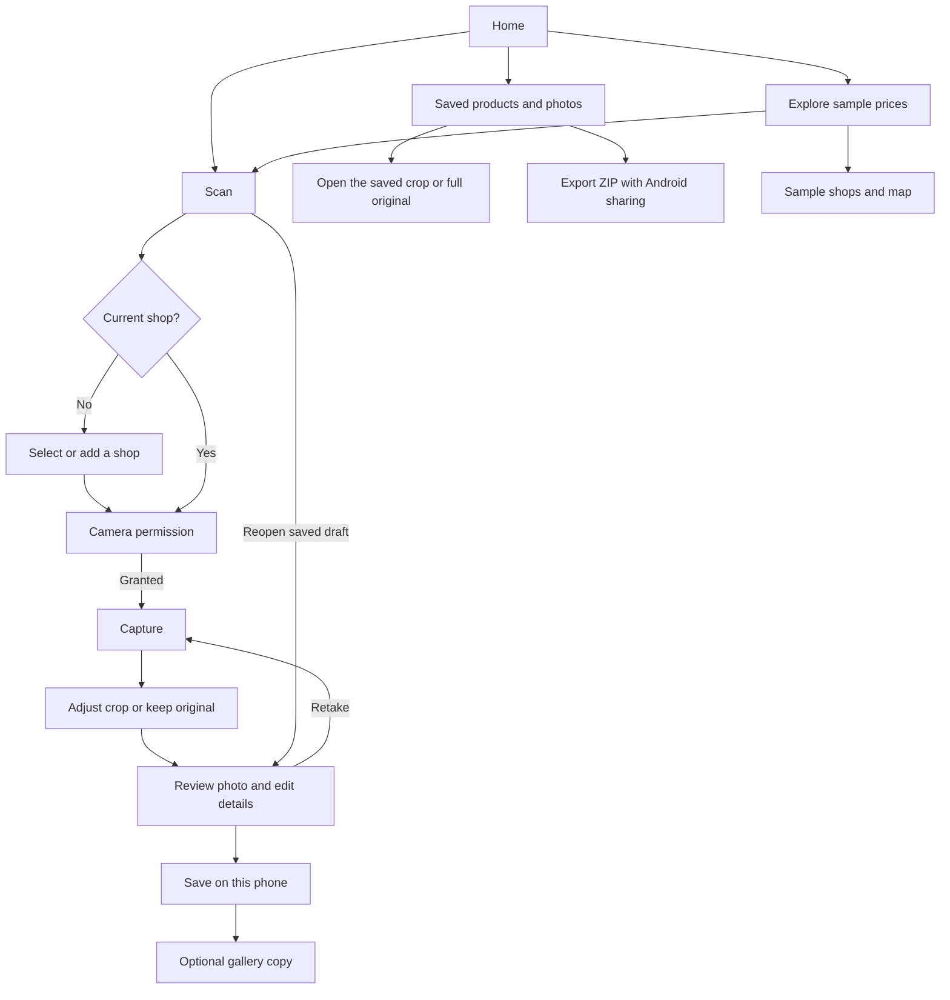

# Cheapo app map

## Current user flow

The [Home route](../apps/mobile/app/index.tsx) shows the current shop and opens
Scan or the sample price browser. Home restores the saved selection when focused.

## Where to make changes

| Responsibility | Current implementation |
| --- | --- |
| Current shop | [Home](../apps/mobile/app/index.tsx) and [Scan](../apps/mobile/app/scan.tsx) use a [shared chooser](../apps/mobile/component/shop/shop-chooser.tsx). The [local shop store](../apps/mobile/data/local-shops.ts) persists saved shops and the current ID. Scan waits for a selection before opening the camera, including from a direct link. |
| Camera | The [Scan route](../apps/mobile/app/scan.tsx) mounts the [camera component](../apps/mobile/component/camera.tsx), which owns permissions, preview, capture, retake, and the photo workflow. |
| Photos | The [crop editor](../apps/mobile/component/photo-crop.tsx) uses [crop geometry](../apps/mobile/data/crop-geometry.ts) and [image manipulation](../apps/mobile/lib/photo-crop.ts). It derives a JPEG from the original and keeps both available in the draft. |
| Review | The [review form](../apps/mobile/component/photo-review.tsx) edits product, price, currency, and optional unit-price details. New drafts store the selected shop's stable ID and display name at capture. A later selection applies to subsequent captures. Older drafts still support their saved free-text shop field. Incomplete details can still be saved as a draft. |
| Storage | The [local photo store](../apps/mobile/data/local-photo.ts) writes JPEGs and a JSON manifest in the app’s private directory. Scan reopens saved drafts. The [gallery helper](../apps/mobile/lib/photo-gallery.ts) copies the selected image only on request after saving. |
| Export | On Android, **Saved products and photos → Export saved products and photos** prepares a private ZIP and opens the Android share sheet. Choose an app or save destination there. The archive contains `manifest.json` (version 1), saved shop details and capture snapshots, manual review values and status, and original and cropped JPEGs linked by relative paths. It excludes sign-in credentials, sessions, logs and device-local paths. Cheapo makes no upload and keeps saved records intact. If a record or photo cannot be read, the export stops. Completed archives stay in Android-managed cache so the chosen app can read them after the share sheet closes. |
| Sample browsing | [Results](../apps/mobile/app/results.tsx) and [Shops](../apps/mobile/app/shops.tsx) use [fictional sample data](../apps/mobile/data/sample-observations.ts). This browse flow is independent of local drafts. |

## Experiments and planned boundaries

- **Development AI.** [Analyse photo](../apps/mobile/component/mobile-draft.tsx) sends the selected image to a paired [Mac companion](../tools/route1-demo/server.mjs) and shows a [separate AI draft card](../apps/mobile/component/results/ai-draft-card.tsx). The manual form and local save use the shopper’s edits.
- **Android sign-in.** In the opt-in auth test build, Home links to [Developer tools](../apps/mobile/app/developer-tools.tsx). The [direct auth screen](../apps/mobile/app/direct-auth.tsx) exercises sign-in and protected session storage. Direct phone photo analysis is unintegrated.
- **Planned.** See the [architecture principles](architecture-principles.md) for intended camera, photo, AI-provider, and persistence boundaries. AI field assignment and cloud storage remain future work.
