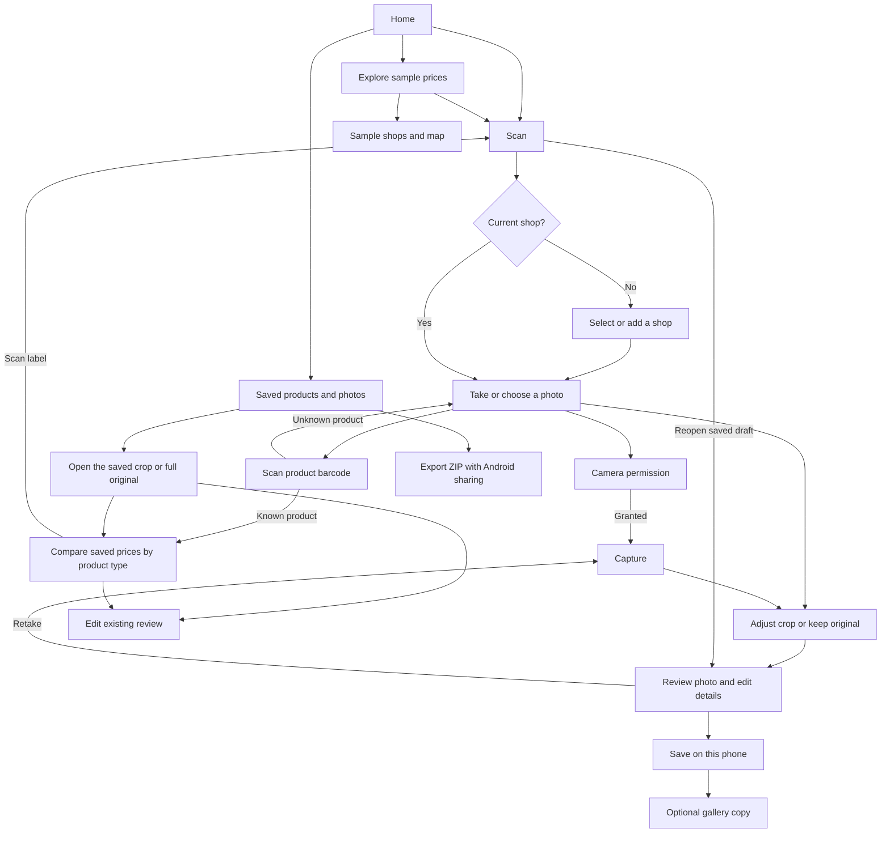

# Cheapo app map

## Current user flow

The [Home route](../apps/mobile/app/index.tsx) shows the current shop and opens
Scan or the sample price browser. Home restores the saved selection when focused. Use **Change shop → Edit** to
update a shop's name, nickname, or address, or remove it from the saved shop list.
Removal clears the current selection if that shop was selected. Previous price
records and photos keep their saved shop details.

## Where to make changes

| Responsibility | Current implementation |
| --- | --- |
| Current shop | [Home](../apps/mobile/app/index.tsx) and [Scan](../apps/mobile/app/scan.tsx) use a [shared chooser](../apps/mobile/component/shop/shop-chooser.tsx). The [local shop store](../apps/mobile/data/local-shops.ts) persists saved shops and the current ID. Scan waits for a selection before opening the camera, including from a direct link. |
| Camera | The [Scan route](../apps/mobile/app/scan.tsx) mounts the [camera component](../apps/mobile/component/camera.tsx), which owns permissions, preview, capture, retake, and the photo workflow. |
| Photos | The [crop editor](../apps/mobile/component/photo-crop.tsx) uses [crop geometry](../apps/mobile/data/crop-geometry.ts) and [image manipulation](../apps/mobile/lib/photo-crop.ts). It derives a JPEG from the original and keeps both available in the draft. |
| Review | The [review form](../apps/mobile/component/photo-review.tsx) edits product, price, currency, and optional type, variety, brand, pack size and unit-price details. If no unit amount and basis were entered, a known pack size supplies the calculated unit price. Product type is a reviewed comparison category, for example dry rice or microwave rice. New drafts store the selected shop's stable ID and display name at capture. A later selection applies to subsequent captures. Older drafts still support their saved free-text shop field. Incomplete details can still be saved as a draft. |
| Storage | The [local price store](../apps/mobile/data/local-photo.ts) writes a JSON manifest in the app’s private directory, with JPEGs for photo reviews. A manually recorded price requires a completed review, product ID and shop snapshot. Scan reopens saved photo drafts. The [gallery helper](../apps/mobile/lib/photo-gallery.ts) copies the selected image only on request after saving. |
| Export | On Android, **Saved products and photos → Export saved products and photos** prepares a private ZIP and opens the Android share sheet. The archive contains `manifest.json`, saved shop details and capture snapshots, manual review values and status, and original and cropped JPEGs linked by relative paths. Version 1 describes photo records. An archive with manual price records uses version 2 and records those observations with `photos: null`. Product IDs appear when an observation was explicitly linked. The export excludes sign-in credentials, sessions, logs and device-local paths. If a record or required photo cannot be read, the export stops. Completed archives stay in Android-managed cache so the chosen app can read them after the share sheet closes. |
| Saved price comparison | [Compare](../apps/mobile/app/compare/%5Bid%5D.tsx) opens from a completed saved review. It compares other completed local reviews of the same type and currency. The variety and brand filters can be used independently or together. Compatible unit prices are normalized and sorted ascending. The lowest comparable price is highlighted, including the selected reference where it is cheapest. Scan label opens the existing camera flow, and Scan product barcode opens barcode scanning. Records without a comparable unit price are shown separately. **Edit** opens the original price and unit in the shared review form. Saving updates only the existing record’s review and refreshes the comparison. |
| Product barcode | [Scan](../apps/mobile/app/scan.tsx) requires a selected shop for both label and [barcode capture](../apps/mobile/component/barcode-scan.tsx). The [local product lookup](../apps/mobile/data/local-products.ts) uses the canonical GTIN to find an exact product ID and its comparison category. The most recent completed observation explicitly linked to that ID can anchor the comparison. An unknown barcode can return to scanning. Existing reviews keep their recorded product types for category comparison. |
| Sample browsing | [Results](../apps/mobile/app/results.tsx) and [Shops](../apps/mobile/app/shops.tsx) use [fictional sample data](../apps/mobile/data/sample-observations.ts). This browse flow is independent of local drafts. |

## Experiments and planned boundaries

- **Development AI.** [Analyse photo](../apps/mobile/component/mobile-draft.tsx) sends the selected image to a paired [Mac companion](../tools/route1-demo/server.mjs) and shows a [separate AI draft card](../apps/mobile/component/results/ai-draft-card.tsx). The manual form and local save use the shopper’s edits.
- **Android field analysis.** The [sign-in screen](../apps/mobile/app/direct-auth.tsx) and [photo analysis control](../apps/mobile/component/direct-photo-analysis.tsx) share one protected phone session. The [provider adapter](../apps/mobile/lib/direct-auth/photo-analysis.ts) checks account model availability, sends only the selected JPEG, and accepts a validated completed draft. The shopper applies suggestions to the manual review before saving. The separate auth test build retains its diagnostic controls.
- **Planned.** See the [architecture principles](architecture-principles.md) for intended camera, photo, AI-provider, and persistence boundaries. Cloud storage remains future work.
